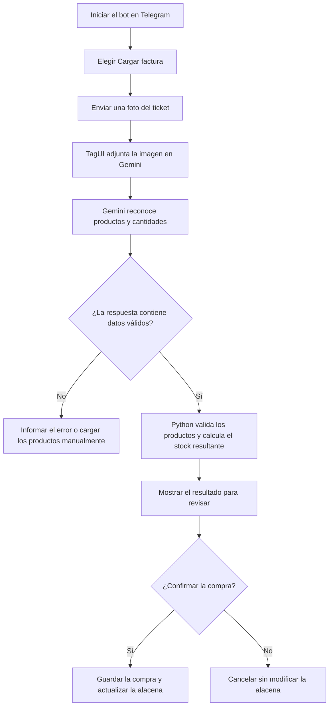

# 📌 UTN FRCU – Tecnologías para la Automatización 2026


## 👥 Grupo
- **Numero de grupo:** 5
- **Miembros:**
 - Aldecoa Ludmila
 - Bertoldi Juliana
 - Braun Molina Magali
 - Rey Florencia
 - Scheffer Catalina


---


## 🤖 Descripcion del Bot
- **Description:** El bot permite consultar y filtrar recetas según los ingredientes disponibles en la alacena; al abrir una receta, indica si se puede preparar o qué ingredientes faltan. También permite cargar facturas o tickets mediante una foto: Gemini reconoce los productos y sus cantidades, y el sistema valida la respuesta, muestra cómo quedaría la alacena y espera la confirmación del usuario antes de guardar la compra.
- **Tecnologia usada:** Python, `rpa` (que utiliza TagUI) para automatizar el navegador, Telegram como interfaz y Gemini como servicio de IA para leer las imágenes.


### 🚀 Descripción de la mejora
- **Qué se mejoró:** Se agregó al bot la opción **🧾 Cargar factura**. TagUI abre Gemini, adjunta la imagen y envía una instrucción para obtener los alimentos en un formato estructurado. Python valida los renglones, calcula el stock resultante y pide confirmación antes de guardar la compra.
- **Consulta de recetas:** Se incorporó un filtro para distinguir las recetas que se pueden preparar con los ingredientes disponibles en la alacena, de las que todavía no. Al entrar en una receta individual, el bot indica si está completa para preparar o detalla los ingredientes y las cantidades que faltan.
- **Por qué:** En la etapa 1, la alacena debía actualizarse manualmente. Registrar las compras desde una foto reduce esa tarea repetitiva y ayuda a mantener actualizado el stock, conservando una verificación humana antes de modificar los datos.
---


## 🛠️ Instrucciones de uso
### Instalaciones para el bot en Linux


Los siguientes comandos se ejecutan desde la carpeta raíz del proyecto `team-13`.


1. Instalar `curl`. En Ubuntu o Debian:
 ```bash
 sudo apt update
 udo apt install php-cli curl
 ```
 TagUI lo utiliza para controlar Telegram Web y Gemini.
2. Crear un entorno virtual e instalar las dependencias del proyecto:
 ```bash
 python3 -m venv .venv
 source .venv/bin/activate
 python -m pip install -r requirements.txt
 ```
3. Si el script de inicio muestra un error con `^M` o `bad interpreter`, convertir sus finales de línea a formato Linux y darle permiso de ejecución:
 ```bash
 sed -i 's/\r$//' Ejecutables/iniciar_bot.sh
 chmod +x Ejecutables/iniciar_bot.sh
 ```
### Establecer conexión con Géminis por TagUI


1. Iniciar sesión en Telegram Web desde la raíz del proyecto:
 ```bash
 python3 Ejecutables/robot_telegram_web.py
 ```
 Seguir la instrucción de inicio de sesión que aparece en la terminal.
2. Para abrir Gemini por primera vez, confirmar que el entorno virtual `.venv` está activo y ejecutar desde la raíz del proyecto:
 ```bash
 OPENSSL_CONF=/dev/null python -c 'import rpa as r; r.init(); r.url("https://gemini.google.com"); input("Inicia sesión en Gemini y presiona Enter para cerrar el navegador..."); r.close()'
 ```
3. En el Chrome que se abre, iniciar sesión con la cuenta de Google y esperar a que cargue Gemini. Después, volver a la terminal y presionar `Enter`; el navegador se cerrará. Si en otra ejecución Gemini solicita autenticación nuevamente, repetir este paso.
4. Antes de cargar facturas, comprobar que la sesión de Gemini siga activa en el Chrome controlado por TagUI.


Para otros sistemas operativos o más detalles, consultar los instructivos de [instalación](docs/instructivo-instalacion.md) y [uso](docs/instructivo-uso.md) de la etapa 1.


### Cargar una factura desde Telegram


1. Enviar `/start` al bot y elegir **🧾 Cargar factura**.
2. Enviar una foto clara del ticket. Gemini procesa la imagen y el bot presenta los productos reconocidos y el stock proyectado.
3. Revisar los nombres y las cantidades. Elegir **✅ Confirmar** para sumar la compra a la alacena, o **❌ Cancelar** para salir sin modificarla. Si falla la lectura, se puede elegir **🥫 Cargar manualmente**.


La foto se envía a Gemini para su procesamiento. No incluir datos personales o información que no se quiera compartir con un servicio externo.


### Flujo de carga de una factura desde Telegram





---


## Problemas
- Durante las pruebas entre Windows y Linux, los scripts `.sh` podían conservar finales de línea de Windows (`CRLF`, visibles como `^M`) y fallar en la terminal de Linux. Se normalizaron los finales de línea a `LF` para su ejecución en Linux.
- En Linux, TagUI podía quedarse en `about:blank` al intentar abrir Gemini. Se completaron dependencias del sistema, incluido `curl`, se configuró la invocación de Python 3 y se aisló temporalmente la configuración de OpenSSL durante el inicio de TagUI para evitar incompatibilidades.
- La lectura depende de la interfaz web de Gemini y de sus selectores. Como la ubicación y los identificadores de los botones pueden cambiar, se agregaron selectores de respaldo para adjuntar la imagen, elegir la opción de subir archivo y enviar la consulta. El proceso prueba estas alternativas hasta encontrar un control disponible, lo que evita que un cambio en el botón principal detenga la carga. También se espera a que la caja de consulta vuelva a estar disponible después de adjuntar la imagen.
- Si Gemini no puede leer el ticket, la respuesta no contiene productos válidos o se cancela la confirmación, la alacena no se modifica. Los productos reconocidos deben usar unidades compatibles (`kg`, `lt` o `unidad`).
- La foto puede ser interpretada incorrectamente, por lo que la revisión y confirmación del usuario es necesaria. La automatización también puede requerir ajustes si Gemini cambia su página o sus selectores.


### 📝 Additional Notes
- Se resolvieron inconvenientes de finales de línea de los scripts de inicio en Linux y de compatibilidad de TagUI con las dependencias y OpenSSL del entorno.
- La interacción con Gemini requiere conexión a internet y una sesión iniciada en el navegador de TagUI. Los cambios de interfaz del servicio pueden requerir actualizar los selectores.
- **Limitaciones restantes:** la precisión depende de la calidad de la foto y de la lectura de Gemini; verificar el resultado antes de confirmarlo. El contenido de la factura se envía a un servicio externo de IA.